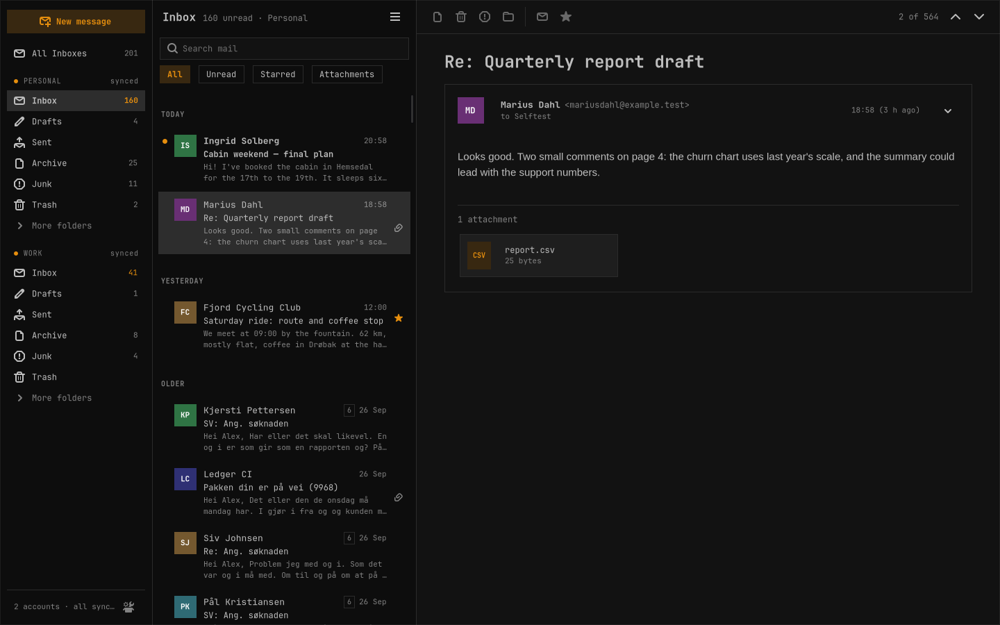

# Sealwax

A fast, beautiful, minimal email client for [Omarchy](https://omarchy.org) — native GTK4 and libadwaita, written in Rust, following your live Omarchy theme and font.

**Status:** M1, the themed shell on a local store, was approved on 2026-10-05: the message list, the reader and the live theme work over a local store of fictional mail. Next is M2, accounts and first sync. Not usable for real mail yet.

- Product requirements: [docs/PRD.md](docs/PRD.md)
- Plan and current state: [docs/PLAN.md](docs/PLAN.md)
- Decisions: [docs/DECISIONS.md](docs/DECISIONS.md)
- Building: [docs/BUILD.md](docs/BUILD.md); testing: [docs/TESTING.md](docs/TESTING.md)
- Working on it with an agent: [AGENTS.md](AGENTS.md)

License: MIT.
