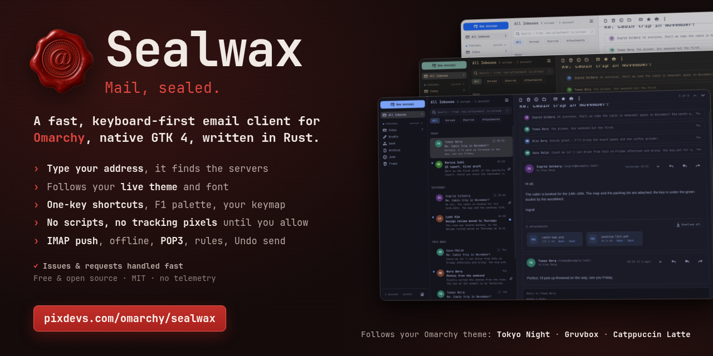

# Sealwax

Mail, sealed. A fast, minimal email client for Linux, made for [Omarchy](https://omarchy.org): native GTK 4 and libadwaita, written in Rust, following your live Omarchy theme and font, quick to drive from the keyboard, and careful with every message: no script in one ever runs, and nothing from the internet loads until you allow it.



## Install

Open a terminal (**Super + Return** on Omarchy), paste this line and press **Enter**:

```sh
curl -L -o /tmp/sealwax.pkg.tar.zst https://github.com/PixDevsApps/sealwax/releases/latest/download/sealwax-x86_64.pkg.tar.zst && sudo pacman -U /tmp/sealwax.pkg.tar.zst
```

Run the same line again to update; **Check for Updates…** in Sealwax's main menu says when there is a new version and gives you the line. To uninstall: `sudo pacman -R sealwax`.

**On other Linux systems** (Fedora, Ubuntu, Mint and others), install the Flatpak from Sealwax's own Flatpak repository:

```sh
flatpak install --user https://github.com/PixDevsApps/sealwax/releases/latest/download/io.github.pixdevsapps.Sealwax.flatpakref
```

It updates with `flatpak update` or your software centre. On Omarchy, the package above is the better fit.

**Your unread count in Omarchy's bar** (optional): this line adds a Sealwax icon to the bar, with the number of unread messages beside it while Sealwax runs. It asks where in the bar to put it: left, center (beside the clock, the default) or right. A click opens Sealwax.

```sh
s=$(gum choose --header "Where in the bar?" --selected center left center right) && d=~/.config/omarchy/plugins/io.github.pixdevsapps.sealwax-unread && mkdir -p "$d" && for f in manifest.json BarWidget.qml; do curl -fsSL -o "$d/$f" https://raw.githubusercontent.com/PixDevsApps/sealwax/main/contrib/omarchy-plugin/$f; done && omarchy-shell shell rescanPlugins && { for i in {1..50}; do omarchy plugin list --json | grep -q '"io.github.pixdevsapps.sealwax-unread"' && break; sleep 0.1; done; omarchy plugin enable io.github.pixdevsapps.sealwax-unread --section "${s/center/centerEnd}"; }
```

To take it off again: `omarchy plugin remove io.github.pixdevsapps.sealwax-unread`. [INSTALL.md](INSTALL.md#unread-count-in-omarchys-bar-optional) has the details.

[INSTALL.md](INSTALL.md) explains every step in plain words: installing, starting, updating and uninstalling, and what to do if something goes wrong. [What's new](CHANGELOG.md) lists each release.

**Need help?** The [user guide](https://pixdevs.com/guides/sealwax/) is online too. No GitHub account? Write to **support@pixdevs.com**; **Help → Contact Support…** in Sealwax's main menu gives you the address and the details that help, and can start the message for you.

## Status

**Version 1.6.1.** The features below are built and tested, and its author has read their own mail with it every day since 7 October 2026: Outlook.com, Microsoft 365 and IMAP, Gmail among them. Testing also covers local test mail servers (Dovecot, Stalwart, Mailpit), a fresh install in a clean Arch Linux container, and measurements on a live desktop; other providers are welcome to report how it goes. The [1.0 release notes](docs/RELEASE_NOTES.md) say what was checked and what wasn't.

## Features

- **Accounts without server settings:** type your address, and Sealwax finds the servers (its provider list, your domain's autoconfig, Mozilla's ISPDB, DNS). **Sign in with Microsoft** for Outlook.com and Microsoft 365; app passwords for iCloud, Fastmail, Yahoo and others, with a link to the provider's page; manual settings for the rest. Several accounts and All Inboxes, each account with a name and a muted colour of your choosing, folding away in the sidebar.
- **IMAP** with IDLE push and an offline copy of your mail, and **POP3** into local folders (mail left on the server by default).
- **Reading:** whole conversations; safe HTML (no message script ever runs; nothing remote loads until you allow it, per message or per sender); attachments that open safely, with a warning for programs and disguised files; link warnings; print, Show Original, Save as `.eml`; graceful display of encrypted and signed mail.
- **Triage:** archive, delete, junk, move, star, read and unread at once, on one message or many, with Undo, also offline; a right-click menu on messages; Empty Trash on a Trash folder's menu; Go to Folder… from the keyboard.
- **Folders and rules:** new subfolders, rename and delete, shown as a tree you can fold; rules in Sieve, the standard mail-filter language, made in a Rules dialog or by hand in `rules/<account>.sieve`, run by Sealwax on new mail (move, copy, mark read, star, junk, delete), with always-junk and never-junk senders and Create Rule from Message.
- **Writing:** a rich-text composer docked in the main window (minimize, expand, several at once), reply, reply all, forward, forward as attachment and a quick reply under the conversation; identities and signatures, plain or designed in a form with your photo or logo and social profiles; attachments with the server's size limit checked; drafts saved as you type and kept on the server; an outbox with Undo send that never sends a message twice; `mailto:` links, and becoming the default mail app when you choose.
- **Search** on this computer with `from:`, `to:`, `subject:`, `sender:`, `domain:`, `has:attachment`, `is:unread`, `is:subscription`, `before:`, `after:` and suggestions as you type; saved searches in the sidebar.
- **Newsletters and senders:** Unsubscribe in one click from a newsletter's header, the way its sender asks, after a dialog that says how; group any folder by sender or by domain to see who fills your inbox, and archive, delete or mark a sender's mail all at once; pin the senders you mustn't miss, so their mail stays at the top of the Inbox.
- **New-mail notifications** that open the message, and **background mode**: closing the window keeps mail syncing; Start Sealwax at Login; the unread count for your bar (`sealwax --unread`, and a widget for Omarchy's bar).
- **Omarchy:** the live theme and font, light and dark; corners that follow Hyprland; no title bar on Hyprland; layouts for wide, half-screen and narrow tiled windows, with panes you can drag wider or narrower.
- **Keyboard first:** one-key shortcuts in the list and reader, a command palette (F1), and your own keys in `keys.toml`. Settings live in plain files: `config.toml`, `keys.toml`, `accounts.toml`.
- **Private:** passwords and tokens only in your keyring; no telemetry; logs without mail content; outgoing mail without your computer's name or a Bcc header.

**Gmail** works with an app password, as [this step-by-step guide](docs/GMAIL.md) shows; there is no Sign in with Google. PGP mail is read and sent with your own GnuPG: decrypted and its signatures checked, signed and encrypted on send. Not yet: server-side search, rules uploaded to the server (ManageSieve), S/MIME, calendars and contacts beyond autocomplete ([release notes](docs/RELEASE_NOTES.md#known-limitations)).

## Requirements

The package: Omarchy, or Arch Linux, on x86_64, with GTK 4.18+, libadwaita 1.9+, WebKitGTK 6.0 2.52+, SQLite 3.45.3+ and a Secret Service such as gnome-keyring; optionally `hunspell` and a hunspell dictionary for spell checking. Omarchy 4 is the desktop it is made for. The Flatpak: any x86_64 Linux system with Flatpak; it brings GNOME's runtime and needs the desktop's secret portal (GNOME and KDE have one) for passwords. Building needs Rust 1.92+.

## Documentation

- [User guide](docs/USER_GUIDE.md): setup (Microsoft sign-in, app passwords, POP3), reading, writing, search, notifications, every keyboard shortcut, theming, the settings files, privacy and troubleshooting
- [Install](INSTALL.md): installing, updating and uninstalling, in plain words; building from source
- [What's new](CHANGELOG.md): each release
- [Release notes for 1.0.0](docs/RELEASE_NOTES.md) (a draft until the sign-off)
- [Security](docs/SECURITY.md): the threat model, the rules and the known limitations; to report a vulnerability, see the [security policy](SECURITY.md)
- [Integrations](docs/INTEGRATIONS.md): Omarchy, Hyprland key bindings and menu entries, providers
- [Microsoft sign-in setup](docs/OAUTH-SETUP.md): registering a client ID
- [Building](docs/BUILD.md) and [testing](docs/TESTING.md)
- [Decisions](docs/DECISIONS.md) and [design](docs/DESIGN.md)

## Thanks

Thanks to everyone who reports bugs and suggests improvements in the [issues](https://github.com/PixDevsApps/sealwax/issues), and especially to [@ocewers](https://github.com/ocewers) for detailed reports and ideas (issues #2 to #8), to [@hurricaane](https://github.com/hurricaane) and [@biddster](https://github.com/biddster) for the ideas behind 1.1 (issues #14, #24, #25 and #26), and to [@alauppe](https://github.com/alauppe), [@chrisonline](https://github.com/chrisonline) and [@mlamoure](https://github.com/mlamoure) for their fixes (pull requests #19, #28 and #33), and to [@lama7](https://github.com/lama7) for Empty Trash (pull request #35).

**Support Sealwax:** Sealwax is free and made by one person in Norway. If it saves you time, you can [sponsor its work on GitHub](https://github.com/sponsors/PixDevsApps), monthly or once.

License: MIT. The licenses of the crates Sealwax is built from come with the package, in `/usr/share/licenses/sealwax/THIRD-PARTY-LICENSES.txt`.
