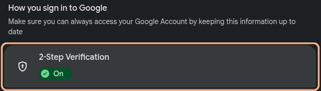
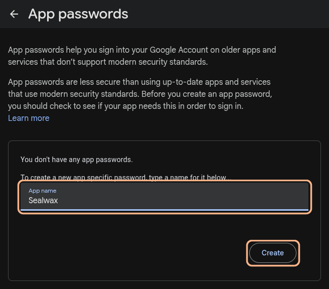
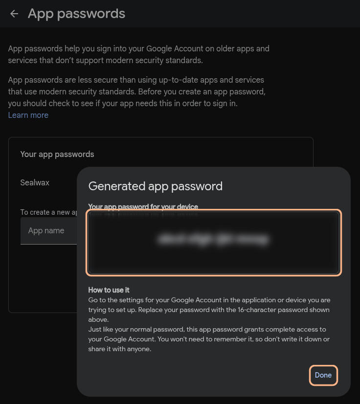
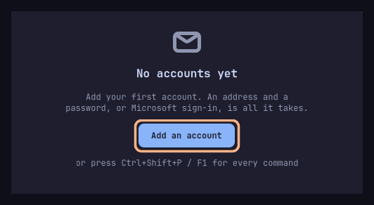
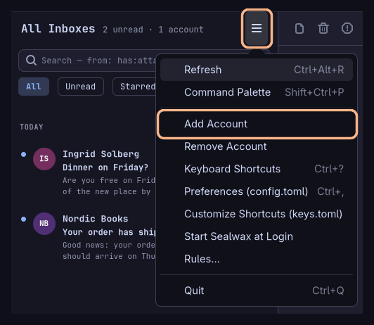
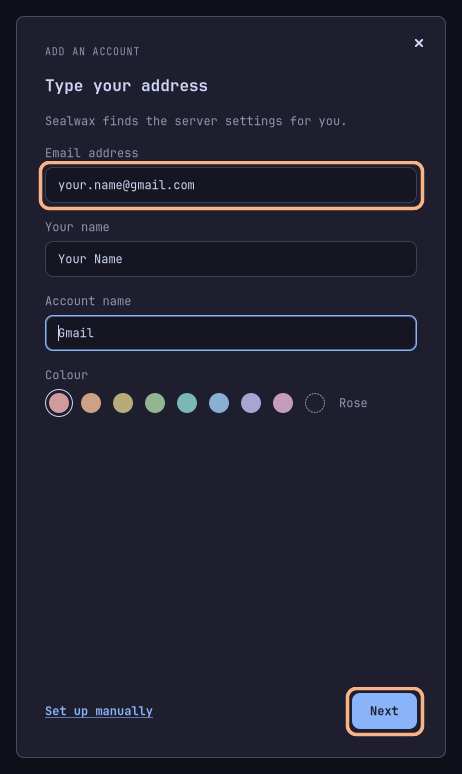
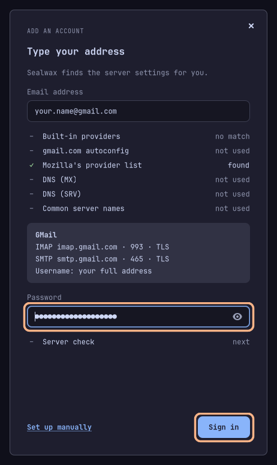
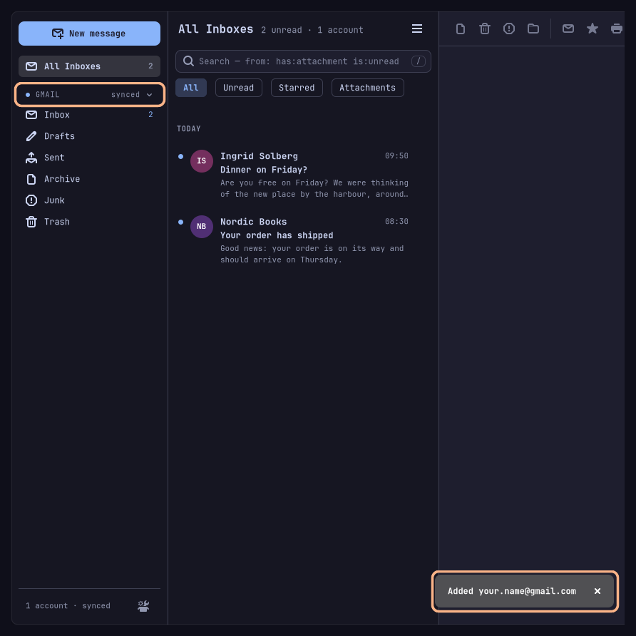
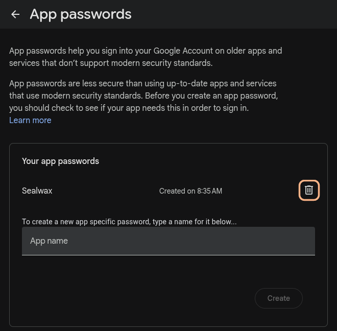

# Gmail in Sealwax

Synced: 2026-10-11

Sealwax has no **Sign in with Google** button. Gmail still works: Google lets mail apps in with an **app password**, a separate password of 16 letters that Google makes for one app. This page shows how to make one and add your Gmail account to Sealwax. You don't need to know anything about mail servers: follow the steps in order.

- [Before you start](#before-you-start)
- [Step 1: Check that 2-Step Verification is on](#step-1-check-that-2-step-verification-is-on)
- [Step 2: Make an app password for Sealwax](#step-2-make-an-app-password-for-sealwax)
- [Step 3: Add your Gmail account to Sealwax](#step-3-add-your-gmail-account-to-sealwax)
- [If something goes wrong](#if-something-goes-wrong)
- [Good to know](#good-to-know)

## Before you start

You need:

- **Sealwax, installed.** [INSTALL.md](../INSTALL.md) shows how.
- **Your Gmail address and your Google password.**
- **Your phone**, if Google asks you to confirm it's you.

Steps 1 and 2 happen on Google's website, in your web browser. Step 3 happens in Sealwax.

## Step 1: Check that 2-Step Verification is on

Google makes app passwords only for accounts that have 2-Step Verification turned on. This is a setting on your Google account: being signed in to Google isn't the same thing. Many accounts have it on already; if you know yours does, go on to [step 2](#step-2-make-an-app-password-for-sealwax).

1. Open [myaccount.google.com/security](https://myaccount.google.com/security) in your web browser, and sign in to Google if it asks. The page is called **Security & sign-in**.
2. Scroll down to **How you sign in to Google**. If **2-Step Verification** says **On**, you're done with this step.

   

3. If it's off, click **2-Step Verification** and follow Google's steps on the screen to turn it on.

## Step 2: Make an app password for Sealwax

1. Open [myaccount.google.com/apppasswords](https://myaccount.google.com/apppasswords). Google may ask for your password again.
2. Under **App name**, type `Sealwax`, and click **Create**.

   

3. Google shows a window called **Generated app password**, with your new app password in a box: 16 letters in four groups, such as `abcd efgh ijkl mnop`. Select the letters and copy them (**Ctrl + C**).

   

   **Keep this window open until you have finished step 3.** Google shows the app password only once. If you close it too soon, no harm done: make a new one the same way.

Don't write the app password down or send it to anyone: it opens your mail. Sealwax keeps it in your computer's keyring.

## Step 3: Add your Gmail account to Sealwax

1. Start Sealwax: press **Super + Alt + Space**, type `Sealwax`, and press **Enter**.
2. Click **Add an account**.

   

   If you already have an account in Sealwax, open the main menu instead (the button with three lines, ☰, at the top of the message list) and choose **Add Account**.

   

3. Type your **Email address** (your Gmail address) and **Your name**: the name people see on the mail you send. **Account name** and **Colour** are up to you: they're how Sealwax shows the account in its sidebar. Click **Next**.

   

4. Sealwax looks up Gmail's settings by itself. After a moment it shows **GMail**, with `imap.gmail.com` and `smtp.gmail.com`. You don't need to change anything there.
5. Click the **Password** field and paste the app password from step 2 (**Ctrl + V**). Not your Google password: the 16 letters. The spaces between the groups of letters can stay.

   Sealwax 0.4.0 also says "Turn on IMAP in GMail's settings first" under the field. **You can skip that:** Gmail always has IMAP turned on, so there is nothing to change in Gmail. Newer versions of Sealwax don't show it.

6. Click **Sign in**.

   

7. Sealwax checks the app password with Gmail, then adds the account. "Added" and your address appear at the bottom of the window, your Gmail account shows in the sidebar, and your mail starts to arrive.

   

You can now click **Done** in Google's window from step 2.

## If something goes wrong

- **Google's app passwords page says the setting isn't available for your account:** 2-Step Verification is off (see [step 1](#step-1-check-that-2-step-verification-is-on)), or the account uses Google's Advanced Protection, or it's a work or school account whose administrator doesn't allow app passwords. In that last case, ask your administrator.
- **Sealwax says "Wrong username or password" or "The server asked for an app password":** the password field has your Google password, or a letter is missing. The eye at the end of the field shows what you pasted. If you no longer have Google's window from step 2, make a new app password ([step 2](#step-2-make-an-app-password-for-sealwax)) and paste it again.
- **Later, Sealwax says the account "needs you to sign in again":** Google no longer accepts the app password, for instance because you deleted it (changing your Google password can also cancel it). Make a new app password, click **Type the password again** in Sealwax, and paste it.
- **Something else:** open an [issue on GitHub](https://github.com/PixDevsApps/sealwax/issues) and say what you did and what you saw. Leave out your email address and passwords.

## Good to know

- **Stop Sealwax's access at any time** at [myaccount.google.com/apppasswords](https://myaccount.google.com/apppasswords): click the bin next to the app password called Sealwax. Your mail stays in Gmail.

  

- **Remove the account from Sealwax** with **Remove Account** in Sealwax's main menu. This deletes the copy of your mail on this computer and the saved app password; your mail stays in Gmail.
- **Your Gmail labels** show as folders in Sealwax, under **More folders**. **Archive** in Sealwax does what it does in Gmail: the message leaves the Inbox and stays in All Mail. **Delete** moves it to Gmail's Trash.
- **Mail you send** is saved in Gmail's Sent folder by Gmail itself, as when you send from Gmail on the web.
- **Why no Sign in with Google?** Before an app like Sealwax may offer that button to everyone, Google requires it to pass a paid security assessment every year. The app password does the same job without it.
- **How well it's tested:** Sealwax's author added their own Gmail account this way on 11 October 2026. Gmail isn't yet among the providers Sealwax is tested with over longer daily use; if something behaves differently from what this page says, an [issue](https://github.com/PixDevsApps/sealwax/issues) helps.

The [user guide](USER_GUIDE.md) explains everything else in Sealwax, from reading and writing mail to rules and keyboard shortcuts.
