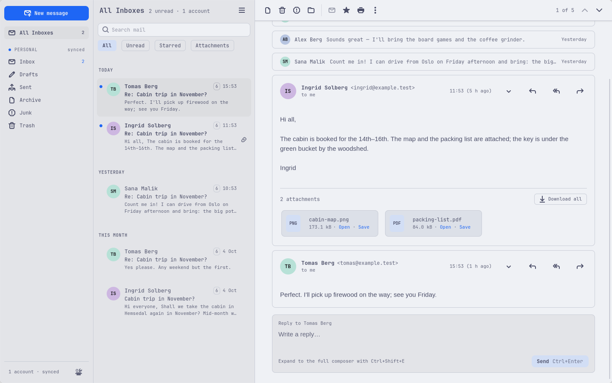

# Sealwax user guide

Synced: 2026-10-09

This guide is for people who use Sealwax every day. It describes Sealwax 0.3.0 as built through M8 (POP3 accounts), before 1.0. Where a command is in the keymap or the menus but does nothing yet, this guide says "not built yet". Every address and name in the examples is fictional.

- [Installing](#installing)
- [First start and adding an account](#first-start-and-adding-an-account)
- [The window](#the-window)
- [Reading mail](#reading-mail)
- [Triage: archive, delete, move, undo](#triage-archive-delete-move-undo)
- [Folders: new, rename, delete](#folders-new-rename-delete)
- [Writing mail](#writing-mail)
- [Search](#search)
- [Notifications and background mode](#notifications-and-background-mode)
- [Keyboard shortcuts](#keyboard-shortcuts)
- [Theme, fonts and corners](#theme-fonts-and-corners)
- [Settings files](#settings-files)
- [Privacy and security](#privacy-and-security)
- [Troubleshooting](#troubleshooting)
- [Removing Sealwax and its data](#removing-sealwax-and-its-data)

## Installing

[INSTALL.md](../INSTALL.md) has the steps: building and installing the Arch package from the PKGBUILD, building from source for development, the runtime dependencies, and uninstalling.

Sealwax is made for Omarchy 4 (Arch Linux, Hyprland), and also runs on other Linux desktops with GTK 4 and a Secret Service such as gnome-keyring.

## First start and adding an account

Start Sealwax from the app launcher, or type `sealwax` in a terminal. Only one Sealwax runs at a time: starting it again shows the window of the one that runs.

With no account yet, the window shows **No accounts yet** and an **Add an account** button, which opens the setup assistant over the window. Later, **Add Account** in the main menu (the menu button at the end of the message list's bar) or in the command palette (F1) opens it again.

### The setup assistant

1. **Email address** and **Your name** (the name the people you write to see); **Account name**, what Sealwax calls the account in the sidebar ("Work", "Personal"; left empty, the address); and **Colour**, one of eight muted colours for the account's heading in the sidebar, or none. The assistant offers the first colour no other account has; Left and Right move between the colours. Then **Next**.
2. **Looking up your provider…** Sealwax finds the server settings itself. It checks, side by side: its built-in list of the big providers, your domain's own HTTPS autoconfig, Mozilla's ISPDB (only the domain is sent), your domain's DNS records (MX and SRV), and finally a few likely server names over TLS. The search stops after 10 seconds at most.
3. **The settings found**, then either a password field or **Sign in with Microsoft**. When the settings came only from your mail provider's servers rather than your own domain, the assistant shows them for you to confirm, with the username. Where a provider gives you an account name that isn't your address, the assistant asks for it.
4. **Checking your login with the server…** Sealwax logs in to the incoming server (IMAP or POP3) and the outgoing server (SMTP) before it saves anything. If the login to settings it found is refused, it tries once more with the other usual username (your full address, or only the part before the @).
5. **Done.** A toast says "Added" and your address, the account's folders appear in the sidebar and its mail starts to sync.

Enter goes to the next step; Escape goes back a step and closes the assistant on the first one. When a login fails, the assistant says why, what to do next and which settings it tried.

The account's settings go into `accounts.toml` ([Settings files](#settings-files)); the password or sign-in token goes into your keyring, never into a file.

### Outlook.com, Hotmail and Microsoft 365: Sign in with Microsoft

Outlook.com and Microsoft 365 accept only Microsoft sign-in for mail apps, so for these addresses the assistant shows **Sign in with Microsoft**:

1. Sealwax opens Microsoft's sign-in page in your default browser and shows "Waiting for the browser…" with **Cancel**. If you closed the tab too soon, **Open the sign-in page again** opens it again.
2. Sign in and approve Sealwax. Sealwax never sees your password; it keeps a sign-in token in your keyring. Your address is not put in the sign-in link.
3. A work or school account may need its organization's admin to approve Sealwax first. The assistant then says "The sign-in was declined".

**The client ID.** Sign in with Microsoft needs a Microsoft client ID: the registration that identifies Sealwax to Microsoft. Sealwax's packages carry one, so with an installed package there is nothing to set up. A build from source has one only if it was given one when it was compiled; you can also give your own in `config.toml`, which wins over a built-in one and applies as soon as you save the file:

```toml
[oauth.microsoft]
client_id = "00000000-0000-0000-0000-000000000000"
```

Without a client ID the assistant says "Microsoft sign-in isn't available in this build of Sealwax yet." and how to set one. [OAUTH-SETUP.md](OAUTH-SETUP.md) shows how to register a client ID in Microsoft Entra. The ID isn't a secret (Microsoft's client for desktop apps is public, and Sealwax keeps no client secret), but keep your own registration out of public repositories.

When Microsoft ends the session later, a banner says that the account "needs you to sign in again", with **Sign in**. A Microsoft account is always an IMAP account in Sealwax; POP3 with Sign in with Microsoft isn't supported.

### Gmail and Google Workspace: not supported

Sealwax doesn't support Gmail: there is no Sign in with Google, and Gmail isn't on the assistant's provider list. Use Gmail's own app or its web version. The assistant may still find Gmail's servers through Mozilla's database, or you can type them in, and a Gmail app password may then work, but that isn't tested or supported.

### iCloud, Fastmail, Yahoo and other app-password providers

Several providers let mail apps in only with an app password, made in the provider's web settings. For iCloud (an app-specific password, with two-factor authentication on), Fastmail, Yahoo, AOL, Yandex and Mail.ru, the assistant names the field **App password** and links the provider's page. For an iCloud address on your own domain, it asks for the username.

Some providers need IMAP turned on in their web settings first (GMX, WEB.DE, mail.com, Zoho and Yandex among them); the assistant says "Turn on IMAP in … settings first." with a link.

Proton Mail works only through Proton Bridge, which this version of Sealwax can't use; Tuta has no IMAP. The assistant says so instead of trying.

### Manual settings

**Set up manually** (at the bottom of the assistant) shows every setting:

- **Incoming mail:** IMAP or POP3;
- the incoming server's name, port and security (TLS, or STARTTLS);
- the SMTP server's name, port and security;
- the username, and the password.

The standard ports are filled in for you: IMAP 993 with TLS or 143 with STARTTLS; POP3 995 or 110; SMTP 465 or 587. **Check settings** logs in to both servers before the account is saved. There is no setting without encryption: Sealwax never connects or sends a password without TLS. A server whose certificate your system doesn't trust (a self-signed certificate) can't be added yet; trusting a single server's certificate comes in a later version.

### POP3 accounts

Choose **POP3** under **Incoming mail** in the manual settings. (Looking up a provider always proposes IMAP.) While POP3 is chosen the assistant says: "Sealwax downloads new mail to folders on this computer and leaves it on the server. To delete it there after some days, set delete_after_days in accounts.toml."

What a POP3 account does:

- **Local folders.** Its Inbox, Sent, Drafts, Junk, Trash and Archive exist only on this computer. Archive, delete, junk, move, read and star work as for IMAP accounts, on this computer only.
- **On the server.** By default, downloaded mail stays on the server and Sealwax never deletes it there. To change that, edit the account's `[account.pop3]` table in `accounts.toml`: `delete_after_days = 30` deletes a message there 30 days after it was downloaded (1 to 3650 days), and `leave_on_server = false` deletes each message there as soon as it is downloaded.
- **Checking.** Sealwax checks a POP3 server when it starts, every 5 minutes, after a reconnect and when you press Refresh (F5 or Ctrl+Alt+R). It downloads the newest mail first. The first download of an account sends no notifications.
- **Read and unread** are kept by Sealwax on this computer: POP3 can't tell the server.
- **A message over 100 MiB** isn't downloaded: it stays on the server and its row shows only its header.
- **Copies of your sent mail and your drafts** are kept in the local folders, not on the server.
- **The server must support UIDL.** Without it the assistant says "This POP3 server can't keep track of messages": use IMAP if the provider offers it. "The mailbox is busy" means another mail app is downloading from the same mailbox, or the server wants a pause between sign-ins.
- **Removing a POP3 account** deletes its local folders for good, with its sent mail, its drafts and any mail the server no longer has.

### More accounts, removing an account, a password typed again

- **Add Account** (main menu, palette) adds another account. **All Inboxes** at the top of the sidebar shows the Inboxes of every account together.
- **Remove Account** (main menu, palette) asks which account and whether, then deletes the account's mail stored on this computer, its password or token in the keyring and its entry in `accounts.toml`. For an IMAP account the mail on the server stays.
- **Editing `accounts.toml` by hand:** an account whose entry you delete by hand is only detached: it stops syncing and leaves the sidebar, but its local mail and its password stay until the entry comes back or you remove the account in Sealwax.
- **Edit Account** (main menu, palette, or a right click on the account's heading in the sidebar) changes what Sealwax calls the account and its colour: **Account name** (empty shows the address) and **Colour**, then **Save**. The name people see on your mail stays. Sealwax writes them as `label` and `color` on the account's entry in `accounts.toml` ([below](#accountstoml)), which you can also edit by hand; the sidebar follows as soon as the file is saved.
- **A password that stops working** (you changed it, or revoked an app password): a banner says the account "needs you to sign in again", with **Type the password again**. The assistant opens at the password; Sealwax checks the new one on both servers before it keeps it ("Password accepted for …").

## The window


Three panes, left to right:

- **The sidebar:** **New message** at the top; **All Inboxes**; each account with its Inbox, Drafts, Sent, Archive, Junk and Trash and their unread counts, its other folders under **More folders** (other mail programs' housekeeping folders are left out: Outlook's Sync Issues and, on Outlook.com and Microsoft 365, Notes and Outbox; Mailspring's folder while it is empty); at the bottom a summary of the accounts and a button that opens `config.toml`. Click an account's heading (or press Enter, Space, Left or Right on it) to fold its folders away under it; folded, the heading shows the account's unread count. Sealwax remembers which accounts are folded. Subfolders show indented under their folder by their own name, the Inbox's under the Inbox; a folder with subfolders has an arrow that folds them away (or press Left on it, and Right to open them again), and Sealwax remembers that too, as it remembers whether **More folders** is open: the sidebar comes back as you left it, also after you rename a folder ([Folders](#folders-new-rename-delete)).
- **The message list:** the search field, the filter chips **All**, **Unread**, **Starred** and **Attachments**, then the messages in sections: Today, Yesterday, This week, This month, Older. A row shows the sender, the time, the subject, a two-line preview, and marks for unread, starred, attachments and the size of the conversation. The **main menu** button is at the end of the list's bar.
- **The reader:** the selected message's conversation ([Reading mail](#reading-mail)).

The layout follows the window's width, so it works tiled:

| Window width | Layout |
| --- | --- |
| 1280 px or more | Sidebar, list and reader |
| 900–1279 px | A narrow rail of icons and counts instead of the sidebar |
| Under 900 px | One pane at a time, with a back button |

**Drag the borders** between the sidebar and the list, and between the list and the reader, to make a pane wider or narrower; double-click a border to put its default width back. The sidebar takes 160 to 360 px and the list 280 to 640 px, and the reader always keeps room for its toolbar. Sealwax remembers the widths. The message in the reader fills the reader's width up to 1,200 px.

On Hyprland the window has no title bar; on other desktops the window controls sit at the ends of the pane bars.

**Account status.** Each account's heading has its name (the account name you gave it, else its address), a dot and a word: synced, syncing…, offline, mailbox full, needs sign-in or bad certificate. An account with a colour shows its name and its synced dot in that colour; a dot that warns stays the warning's colour. A state that needs you shows as a **banner** across the top of the window, the most important first: no keyring, a certificate that no longer verifies, a sign-in or password needed, a message that may have been sent, a full mailbox, offline. Short results (archived, sent, saved) show as **toasts** at the bottom.

**What syncs.** Sealwax keeps a copy of your mail on this computer, so the list shows at once and works offline. New mail in the Inbox arrives as soon as the server reports it (IMAP IDLE); the account's other folders are checked every couple of minutes, and **Refresh** (F5, Ctrl+Alt+R or the main menu) checks every account now. A folder's first sync keeps its last 90 days of mail (at least 200 messages, at most 5,000); scroll to the end of the list to load older messages, 200 at a time ("Loading older messages…"). Inbox, Sent, Drafts, Archive, Junk and Trash sync by themselves; another folder syncs once you have opened it. The unread counts are the server's, including mail older than what the list holds.

**The command palette** (F1 or Ctrl+Shift+P) lists every command that is available right now; type to filter, Enter runs the selected one, Escape closes it. **Keyboard Shortcuts** (`?`, `h` or Ctrl+?) lists every key and where it works.

## Reading mail

**Conversations.** Selecting a message shows its whole conversation in the reader, oldest first. The selected message, unread ones and the latest are expanded as cards; the others are one-line rows that a click, Enter or Space expands. A conversation of over 100 messages folds its middle ("N earlier messages"). **Expand All Messages** and **Collapse All Messages** are in the reader's More menu and the palette. `n` and `p` move to the next and previous message in the conversation. A message the reader shows is marked read. A card's details button shows From, Reply-To, To, Cc, the full date and the mailing list.

**HTML mail.** No script in a message ever runs. Plain text and simple HTML take your theme's colours and fonts. A styled message, such as a newsletter or a receipt, keeps its own design on a light "paper" card, and a message with its own dark design shows it under a dark theme.

**Remote images.** Images and other content from the internet are hidden until you allow them, so a sender can't tell when or where you opened a message. Each message's banner says "Images are hidden so the sender can't tell you opened this.":

- **Show images** loads them for this message until Sealwax quits.
- **Always for this sender** loads them in every message from this address from now on; such a message shows "Images from this sender are always shown." with **Hide**, which forgets the sender.

Allowed images load only over HTTPS and without cookies. A forged From address can borrow a listed sender's permission; the images then tell the forger that you opened the message, which is what remote images always tell.

**Attachments.** Each attachment has a card with its type, name and size, **Open** and **Save**; **Download all** saves every one into a folder. Open copies the file into a private folder and opens it with your default app for its type. A program, script, launcher or installer, or a file whose name hides its type, has a warning sign and only **Save**: "Sealwax won't open this file: it can run programs on your computer. Save it only if you trust the sender." In a large message the attachments download when you ask for them ("Downloading…", with Cancel, and Retry after a failure).

**Links.** Pointing at a link, or moving the keyboard focus to it, shows its real address at the bottom-left of the reader. When a link's text names another domain than the one it opens, or its address hides a name before an @, the reader warns ("The link text and its target differ") and asks "Open this link?" with Cancel as the default. Links open in your browser, never inside Sealwax.

**Print, Show Original, Save as .eml.** **Print…** (Ctrl+P) opens the print dialog with the message and a header (subject, From, To, Cc, Date). **Show Original** (Ctrl+U) shows the message's raw source (its first 512 KiB) with **Save as .eml…**. **Save as .eml…** (Ctrl+S) saves the whole message as a file, suggesting its subject as the name.

**Encrypted and signed mail.** Sealwax 1.0 doesn't decrypt or check PGP and S/MIME. An encrypted message shows "This message is encrypted. Sealwax can't read encrypted mail yet." in place of its body; a signed message shows its content with "Signed · not checked".

## Triage: archive, delete, move, undo

| Command | Keys | What it does |
| --- | --- | --- |
| Archive | `e`, `y` | Moves to the account's Archive folder (or, where a server has no Archive but an All Mail folder, into that); unavailable where an account has neither |
| Delete | `#`, Delete | Moves to the Trash; in the Trash (or without one) deletes for good |
| Move to Junk | `!`, Ctrl+J | Moves to Junk; in Junk it is **Not Junk** and moves back to the Inbox |
| Move to… | `v`, Ctrl+Shift+V | Opens a folder picker: type to filter, Up and Down, Enter moves, Escape closes |
| Star or Unstar | `s` | Stars the messages, or unstars them when all are starred |
| Mark as Read, Mark as Unread | Shift+I, Shift+U | |
| Mark Folder as Read | — | A right-click on a folder in the sidebar (or Menu, or Shift+F10), or the palette |
| Undo | `z`, Ctrl+Z | Undoes the last action |

The same commands are buttons in the reader's toolbar, and hovering a row shows archive, delete and star for that row. A button that doesn't apply says why in its tooltip ("already archived", "the account has no Junk folder").

**Undo.** An action that moves messages or changes several shows a toast, such as "Archived 3 messages", with **Undo** for 7 seconds. `z` or Ctrl+Z undoes the last action while it still can be, also after the toast has gone. Deleting for good waits for those 7 seconds before it reaches the server, so it can be undone too.

**Several messages.** Ctrl+click adds a message, Shift+click selects a range, and Shift with `j`/`k` or Down/Up extends the selection from the keyboard. `x` or Space selects the message under the cursor and turns the list into a select mode with checkboxes, where `j`/`k` move without changing the selection. Every command applies to every selected message; the reader shows how many are selected, with buttons. Escape leaves the select mode. Move to… can't move messages between accounts.

**Offline.** Every action shows at once, on this computer, and waits for the server when it can't be reached. The offline banner counts what waits ("3 waiting") and Sealwax sends it when the network is back. If a server refuses a change, a toast says so and the messages are back where they were.

## Folders: new, rename, delete

Right-click a folder in the sidebar (or press Menu or Shift+F10 on it) for **New Subfolder…**, **Rename Folder…** and **Delete Folder…**; right-click an account's heading for **New Folder…** at the top of the account. The palette's **New Folder…**, **Rename Folder…** and **Delete Folder…** act on the folder the list shows. None has a key; `keys.toml` can give them one (`new-folder`, `rename-folder`, `delete-folder`).

- **Names.** Type the folder's name and press Enter or **Create** (**Rename**). Sealwax checks the name as you type and says why one can't be used: it is empty, it holds the character that separates folders on that account (`/` or `.`), `*` or `%`, or a line break, a folder beside it has that name already (whatever the case), or it is a name Sealwax hides (Sync Issues, and on Outlook.com and Microsoft 365 Notes and Outbox, at the top of the account; Mailspring). Names may have any other letters, æ, ø, å and emoji included.
- **Special folders** (Inbox, Drafts, Sent, Archive, Junk, Trash) keep their names and places: they can't be renamed or deleted, and neither can a folder that holds one. They can have subfolders. Some servers mark a folder as one that can't have subfolders; New Subfolder is then unavailable, and its tooltip says why.
- **Where a new folder goes.** New Subfolder makes it under the folder; New Folder at the top of the account, or, on servers that keep every folder under the Inbox, under the Inbox.
- **Renaming** a folder renames the folders under it too. Its messages stay, already downloaded, and an open folder stays open.
- **Deleting** asks first: "Delete “Kunder” and everything in it?", with how many subfolders and messages go. **The server deletes them for good**; Cancel is the default. A deleted folder that was shown leaves the list at the account's Inbox.
- **Online only.** An IMAP account's folders change on its server, so the account must be connected: offline, the dialog says so and sends nothing. A POP3 account's folders are on this computer and change at once.
- **The result** shows as a toast: "Created “Reiser”", or why not, a server's refusal in the server's own words. Sealwax subscribes to the folders it makes and renames, so other mail programs that show only subscribed folders see them too.

Move to… shows a subfolder by its own name with the folders above it beside it ("Acme" · "Kunder / 2026").

## Rules

Rules sort new mail for you: move it to a folder, copy it, mark it read, star it, send it to Junk or bring it back from Junk. Each account has its own rules. Sealwax runs them itself, on the mail that arrives in the account's Inbox and Junk while Sealwax runs (background mode keeps it running with the window closed), so they work with every account, Outlook.com and POP3 accounts included. Rules see a message's headers (From, To, Subject, List-Id and the rest), not its text.

**The message menu.** Right-click a message (or press Menu or Shift+F10 on it) for **Reply**, **Reply All** and **Forward**; **Archive**, **Delete**, **Move to…** and **Move to Junk** (**Not Junk** in Junk); **Mark as Read** or **Unread** and **Star** or **Unstar**; and the rules' commands: **Create Rule from Message…**, **Always Junk Messages from** *the sender* and **Never Junk Messages from** *the sender*. A message you right-click that isn't selected is selected first; one in a selection acts with all the selected messages.

**Always junk and never junk.** *Always Junk Messages from* puts the sender's address on the account's always-junk list and moves the messages to Junk at once; mail from that address goes to Junk from now on. *Never Junk Messages from* puts it on the never-junk list and brings the messages back from Junk to the Inbox; mail from that address that lands in Junk (your provider's spam filter put it there) comes back to the Inbox. The toast says what happened, and **Undo** (or `z`) takes back both the move and the list. An address on one list leaves the other.

**The Rules dialog.** **Rules…** in the main menu or the palette shows the rules of the account the list shows; right-click an account's heading for that account's. Every change is saved at once.

- **New Rule** opens the editor: a name, "If all / any of the following", conditions and actions. A condition reads From, To, Cc, To or Cc, Subject, List-Id, Reply-To, any header by its name ("A header…") or the size, and compares it: contains, doesn't contain, is, isn't, begins with, ends with, or matches (`*` for any text, `?` for one character). "From is" compares the address alone (`kari@example.test`); "From contains" reads the name too. With no condition the rule acts on every message. Actions: Move to folder, Copy to folder, Mark as read, Star, Move to Junk, Not junk, Delete (to the Trash: rules never delete for good), and Stop processing more rules. **Save** stays unavailable until the rule is complete, and says what is missing.
- **A rule you save runs at once on the mail already in the account's Inbox**, alone: a new rule, or one whose conditions or actions you changed (not one that is switched off). What it moves leaves the Inbox and shows only where it went; a toast in the dialog says so ("Moved 2 messages from Inbox to Kunder", or "No message in Inbox matches “Kunder”"), with **Undo**, which `z` and Ctrl+Z in the main window also do while it is your last action. The moves reach the server after a few seconds, as your own moves do.
- **Create Rule from Message…** fills a new rule in from the message: "From is" its sender, or "List-Id contains" its list for mail from a mailing list, and a move to a folder for you to choose.
- Each rule shows its name and what it does in one line, an on/off switch, **Move Up** and **Move Down** (rules run in order; Stop ends the run), **Edit** and **Delete** (with Undo).
- **Always junk** and **Never junk** list the senders, each with a remove button, and a field to add an address, or a domain for every address at it (`example.test`).
- **Apply to Folder…** runs the rules now on every message a folder holds; so does **Apply Rules to This Folder** in a folder's right-click menu or the palette (on the folder the list shows). A toast says how many messages the rules changed, with **Undo**. Apart from a rule you just saved, rules don't run on the mail an account had when it was set up unless you apply them.

**The file.** An account's rules are a Sieve script (RFC 5228, the standard language for mail filters, which Dovecot, Fastmail, Roundcube and others use), `~/.config/sealwax/rules/<key>.sieve` (the account's `key` in `accounts.toml`), written in Roundcube's form (`# rule:[Name]` above each rule). You can edit it in a text editor; Sealwax reads it again at the next new mail, and the dialog shows what it recognises. Parts it doesn't recognise as rules show as "Written by hand" and run as written; the dialog then says "Edited by hand" and has **Open File**. Sealwax runs `require`, `if`/`elsif`/`else`, `stop`, `keep`, `fileinto` (with `:copy`), `discard`, `addflag`/`setflag`/`removeflag`, and the tests `address`, `header`, `exists`, `size`, `allof`, `anyof`, `not`, `true`, `false`, `hasflag` and `environment` (`imap.mailbox`); a script that uses anything else, or doesn't parse, runs nothing. Then a banner says "Rules in *account* can't run" with the line, the column and what is wrong, and **Open File**; it goes when the file is fixed. If the file changes in a text editor while the Rules dialog is open, the dialog shows the file again instead of writing over it.

**Folders.** Renaming a folder in Sealwax takes the rules that file into it along; deleting one leaves them, and a rule filing into a missing folder leaves the message where it is (the dialog marks the folder "missing").

The rules' commands have no keys; `keys.toml` can give them one (`edit-rules`, `new-rule-from-message`, `junk-sender`, `trust-sender`, `apply-rules`).

## Writing mail

**The composer.** **New message** (or `c`, Ctrl+N) opens a composer at the bottom right of the main window, over the mail, as in Gmail. It has:

- the **From** chip: the account's address and its other identities;
- **To**, with **Cc · Bcc** to add those fields; recipients become chips, and suggestions come from the addresses in your mail, people you have written to first;
- **Subject**;
- a formatting toolbar: paragraph style (Paragraph, Heading 1–3, Preformatted), bold, italic, underline, strikethrough, bulleted and numbered lists, link, quote, indent, outdent, clear formatting and undo;
- the body;
- attachments, "Draft saved" with the time, and **Send** (Ctrl+Enter).

The buttons at the right of its header **minimize** it to a bar at the bottom of the window (it shows the subject; click the bar to open it again), **expand** it to a larger card in the middle of the window (click beside it, or **Shrink**, to put it back), and **close** it, keeping the draft. You can have several open at once: each new one opens to the left of the others, and the oldest minimize when there is no more room. In a narrow window the composer fills the window. While you write, the window's own shortcuts still work: Ctrl+N starts another message, and the command palette (Ctrl+Shift+P or F1) also lists the composer's commands. Minimizing or closing the composer puts the keyboard focus back where it was. Without a Sealwax window open (a `mailto:` link, `sealwax --compose`), the window opens with the composer in it. Closing the window keeps every draft in it.

Pasted text keeps simple formatting and loses the rest; **Paste as Plain Text** (Ctrl+Shift+V) pastes it without any. Spell checking works when a hunspell dictionary for your language is installed (`hunspell-en_us`, for example); the languages come from your locale.

**Reply, Reply All, Forward.** `r` (Ctrl+R), `a` (Ctrl+Shift+R) and `f` (Ctrl+L), or the three buttons on each expanded message's card. They answer the message you are on in the reader. A reply goes out from the address the message was sent to, when that is one of your identities.

**Quick reply.** Under a conversation there is a plain-text box, "Reply to" and a name. Ctrl+Enter sends; **Open Reply in Composer** (Ctrl+Shift+E) moves what you typed into a full composer. What you type is saved as a draft, so it is there again after a restart.

**Drafts.** Sealwax saves a draft while you type, at most a few seconds behind you, and keeps a copy in the account's Drafts folder on the server (on this computer only for POP3 accounts). Closing the composer keeps the draft; a new message closed before you typed anything is thrown away. **Discard Draft** deletes it, and asks first when there is something to lose. A message in a Drafts folder opens in the composer with Enter, `o` or a double click, or **Edit draft** on its card.

**Attachments.** **Attach File…** in the composer's header, or drag files onto the composer. An image pasted into the text goes into the message itself. Sealwax knows how large a message your outgoing server takes: a message that is too large shows a warning and isn't sent ("Not sent: … is more than this account's server takes").

**Identities and signatures** are set in `accounts.toml` ([below](#accountstoml)): `signature` on an account, and an `[[account.identity]]` table for each other address the account sends from, with its own name and signature. A signature is plain text, put under what you write after a `-- ` line.

**Sending.** Send closes the composer and the main window shows "Message queued" with **Undo** for 7 seconds (`z` and Ctrl+Z work too); Undo puts the draft back in a composer. Then "Message sent". Without a network, the message waits in the outbox and goes when the network is back. A copy goes into the Sent folder, unless the server files one itself (Outlook.com and Microsoft 365 do).

- **Sent at most once.** If Sealwax stopped, or the connection broke, while a message was going out, Sealwax can't know whether the server got it. Instead of sending it again by itself, it shows a banner, "A message may have been sent", with **Choose…**: Send Again, It Was Sent, Back to Drafts or Later. Look in your Sent folder, or ask a recipient, before you send it again.
- **A send that failed for good** (the server refused a recipient, for example) shows a toast that says why; the message is back in your drafts, and **Open** opens it. If Sealwax stopped while it was preparing a message to send, the message comes back the same way the next time Sealwax starts, and isn't sent until you send it again.

Outgoing mail carries no name of your computer and no Bcc header, and Sealwax adds no "sent with" field.

**`mailto:` links.** `sealwax mailto:someone@example.com` opens a composer with the link's address, subject and text; links in your browser do the same once Sealwax is the default mail app. **Make Sealwax the Default Mail App…** (in the palette) says what it changes and how to undo it, and asks first; only an installed Sealwax can be the default. Attachments named in a `mailto:` link are always ignored. `sealwax --compose` opens a new message.

## Search

Press `/` or Ctrl+F (or click the search field) and type: the results follow every key. Escape ends the search. The chips filter the results too.

| Operator | Finds | Example |
| --- | --- | --- |
| `from:` | The sender's name or address | `from:anna` |
| `to:` | A recipient's name or address | `to:team@example.com` |
| `subject:` | Words in the subject | `subject:invoice` |
| `has:attachment` | Messages with attachments | `has:attachment` |
| `is:unread`, `is:read`, `is:starred` | Unread, read or starred messages | `is:unread` |
| `before:` | Sent before a day | `before:2026-10-01` |
| `after:` | Sent on or after a day | `after:2026-09-01` |

- **Words and phrases:** plain words are searched in the subject, the sender and recipients, the text and the attachments' names. `"quoted words"` must appear together. The last word you are typing counts as the start of a word until you type a space.
- **Leaving things out:** `-word`, `-"a phrase"`, `-has:attachment` and `-is:unread` exclude; `-before:` reads as `after:`.
- **Days** are local days, written `2026-10-01`, `2026/10/01`, `1.10.2026`, `2026-10` (its first day) or `2026` (1 January).
- **Letters:** æ and ø are found whether you type them or not (`blabaersyltetoy` finds "blåbærsyltetøy"). `has:attachments` and `is:flagged` work as aliases.

**Suggestions** open under the field as you type: the operator that two letters start, the values of `has:` and `is:`, people from your contacts after `from:` and `to:`, and days after `before:` and `after:`. Down with no suggestions open lists every operator. Down and Up choose, Tab takes the chosen suggestion (or the first), Enter takes a chosen one and otherwise goes to the results, and Escape closes the suggestions (a second Escape ends the search).

**Where it searches.** In a folder, a search covers that folder, and a row under the chips offers **Search in** that folder or **All folders**. In All Inboxes it covers every folder. A search of every folder leaves out Trash and Junk (search inside them to find their mail).

**What it searches.** Search runs on this computer, over the mail Sealwax has stored: every synced message's headers and preview, and the full text of messages that have been downloaded (Inbox mail from the last 14 days downloads in the background; other messages when you open them; text past the first 256 KiB of a message isn't indexed). Searching on the server comes in a later version. **Rebuild Search Index** (in the palette) indexes the stored mail again; search keeps working while it runs.

## Notifications and background mode

**New-mail notifications.** New unread mail in an Inbox shows a desktop notification with the sender as its title and the subject as its text. None shows while Sealwax's window is focused on that Inbox or on All Inboxes. Up to three show one by one within 30 seconds; more become one notification, "N new messages", naming the senders. A click opens the message in Sealwax, with a new window if none is open. A notification goes away when its message is read, moved or deleted anywhere. Archive and Mark Read buttons show only where the notification server shows buttons; Omarchy's doesn't. The first sync of an account sends none; mail that arrived while Sealwax wasn't running is notified when it starts.

In `config.toml`, `[notifications] show = "count"` shows only "New mail" and how many messages came, never a sender or subject; `enabled = false` turns notifications off. Omarchy's notification server keeps recent notifications in `~/.local/state/omarchy/notifications/`, so the count mode keeps senders and subjects out of that folder too.

**Background mode.** Closing the window leaves Sealwax running, so mail keeps syncing and notifications keep coming. The first time, a notification says "Sealwax keeps running" and how to quit. Starting Sealwax again (the launcher, a key binding, `sealwax`, a notification) shows a new window at once.

- To **quit**, press Ctrl+Q in a Sealwax window, choose Quit in the main menu, or run `pkill -TERM -x sealwax`. Open drafts are saved first.
- To make closing the window quit, set `enabled = false` under `[background]` in `config.toml`.

**Start Sealwax at Login** (a check item in the main menu, and in the palette) asks first, then writes `~/.config/autostart/io.github.pixdevsapps.Sealwax.desktop`, which runs `sealwax --background` at login: Sealwax starts without a window, so mail syncs from the start. Turning it off deletes that file. A change takes effect at your next login. `sealwax --background` does the same by hand.

On Omarchy you can open Sealwax with a key binding (SUPER+SHIFT+E, say) and add it to the Omarchy menu: [INTEGRATIONS.md](INTEGRATIONS.md#hyprland) has snippets to paste into your own Hyprland and menu files (Sealwax never edits them itself; the snippets are not tried on a live desktop yet).

## Keyboard shortcuts

Where a key works depends on the key:

- **One-key shortcuts** (`e`, `j`, `#` …) work only while the message list or the reader has the keyboard focus, so the search field and the composer keep their letters.
- **Keys with Ctrl or Alt, and F-keys,** of window commands (Compose's Ctrl+N, Search's Ctrl+F, the palette, Refresh, Quit) work anywhere in the window. The message commands' Ctrl keys (Ctrl+J, Ctrl+R …) work in the list and the reader.
- **The composer's keys** all use Ctrl.
- **Two-key sequences** such as `g` then `i`: the second key must follow within 1.5 seconds; a mistyped sequence does nothing.

Every key works on the US and Norwegian layouts without AltGr, none uses Super (it belongs to Hyprland), every key that needs Shift for its symbol (`#`, `/`, `!`, `?`) has an alternative without one, and every F-key has an alternative.

The full keymap, with each command's name in `keys.toml` (a test keeps this table identical to the keys Sealwax installs):

<!-- keymap table: generated from the registry -->
| Category | Command | Keys | Keys work | `keys.toml` name |
| --- | --- | --- | --- | --- |
| Navigation | Next Message | j, Down | j: list and reader; Down: the list's own | `next-message` |
| Navigation | Previous Message | k, Up | k: list and reader; Up: the list's own | `previous-message` |
| Navigation | Next Message in Conversation | n | list and reader | `next-in-conversation` |
| Navigation | Previous Message in Conversation | p | list and reader | `previous-in-conversation` |
| Navigation | Open Message | Enter, o | list | `open-message` |
| Navigation | Back to List | Escape, u | reader | `back-to-list` |
| Navigation | Search | /, Ctrl+F | /: list and reader; Ctrl+F: anywhere | `search` |
| Navigation | Go to Inbox | g then i | list and reader | `go-to-inbox` |
| Navigation | Go to Starred | g then s | list and reader | `go-to-starred` |
| Navigation | Go to Sent | g then t | list and reader | `go-to-sent` |
| Navigation | Go to Drafts | g then d | list and reader | `go-to-drafts` |
| Messages | Archive | e, y | list and reader | `archive` |
| Messages | Delete | #, Delete | list and reader | `delete` |
| Messages | Move to Junk | !, Ctrl+J | list and reader | `junk` |
| Messages | Move to… | v, Ctrl+Shift+V | list and reader | `move-to` |
| Messages | Star or Unstar | s | list and reader | `star` |
| Messages | Mark as Read | Shift+I | list and reader | `mark-read` |
| Messages | Mark as Unread | Shift+U | list and reader | `mark-unread` |
| Messages | Mark Folder as Read | — |  | `mark-folder-read` |
| Messages | New Folder… | — |  | `new-folder` |
| Messages | Rename Folder… | — |  | `rename-folder` |
| Messages | Delete Folder… | — |  | `delete-folder` |
| Messages | Select | x, Space | list | `select` |
| Messages | Undo | z, Ctrl+Z | list and reader | `undo` |
| Messages | Print… | Ctrl+P | list and reader | `print` |
| Messages | Show Original | Ctrl+U | list and reader | `show-original` |
| Messages | Save as .eml… | Ctrl+S | list and reader | `save-message` |
| Compose | Compose | c, Ctrl+N | c: list and reader; Ctrl+N: anywhere | `compose` |
| Compose | Reply | r, Ctrl+R | list and reader | `reply` |
| Compose | Reply All | a, Ctrl+Shift+R | list and reader | `reply-all` |
| Compose | Forward | f, Ctrl+L | list and reader | `forward` |
| Compose | Send | Ctrl+Enter | composer | `send` |
| Compose | Edit Draft | — |  | `edit-draft` |
| Compose | Quick Reply | — |  | `quick-reply` |
| Compose | Open Reply in Composer | Ctrl+Shift+E | reader | `reply-in-composer` |
| Compose | Attach File… | — |  | `attach-file` |
| Compose | Add Cc and Bcc | — |  | `show-cc-bcc` |
| Compose | Discard Draft | — |  | `discard-draft` |
| Compose | Bold | Ctrl+B | composer | `bold` |
| Compose | Italic | Ctrl+I | composer | `italic` |
| Compose | Underline | Ctrl+U | composer | `underline` |
| Compose | Strikethrough | — |  | `strikethrough` |
| Compose | Bulleted List | — |  | `bulleted-list` |
| Compose | Numbered List | — |  | `numbered-list` |
| Compose | Link… | Ctrl+K | composer | `insert-link` |
| Compose | Quote | — |  | `quote` |
| Compose | Indent | — |  | `indent` |
| Compose | Outdent | — |  | `outdent` |
| Compose | Clear Formatting | — |  | `clear-formatting` |
| Compose | Undo Typing | Ctrl+Z | composer | `composer-undo` |
| Compose | Redo Typing | Ctrl+Shift+Z, Ctrl+Y | composer | `composer-redo` |
| Compose | Paste as Plain Text | Ctrl+Shift+V | composer | `paste-as-text` |
| View | Expand All Messages | — |  | `expand-all` |
| View | Collapse All Messages | — |  | `collapse-all` |
| View | Show Images | — |  | `show-images` |
| View | Always Show Images from This Sender | — |  | `always-show-images` |
| View | Refresh | Ctrl+Alt+R, F5 | anywhere | `refresh` |
| View | Toggle Sidebar | Ctrl+Shift+S, F9 | anywhere | `toggle-sidebar` |
| View | Command Palette | Ctrl+Shift+P, F1 | anywhere | `command-palette` |
| General | Add Account | — |  | `add-account` |
| General | Edit Account | — |  | `edit-account` |
| General | Remove Account | — |  | `remove-account` |
| General | Keyboard Shortcuts | ?, h, Ctrl+? | ?, h: list and reader; Ctrl+?: anywhere | `shortcuts` |
| General | Preferences (config.toml) | Ctrl+, | anywhere | `preferences` |
| General | Customize Shortcuts (keys.toml) | — |  | `customize-shortcuts` |
| General | Rebuild Search Index | — |  | `rebuild-search-index` |
| General | Start Sealwax at Login | — |  | `start-at-login` |
| General | Make Sealwax the Default Mail App… | — |  | `default-mail-app` |
| General | Quit | Ctrl+Q | anywhere | `quit` |
| Rules | Rules… | — |  | `edit-rules` |
| Rules | Create Rule from Message… | — |  | `new-rule-from-message` |
| Rules | Always Junk Messages from Sender | — |  | `junk-sender` |
| Rules | Never Junk Messages from Sender | — |  | `trust-sender` |
| Rules | Apply Rules to This Folder | — |  | `apply-rules` |
<!-- end of the keymap table -->

"—" means the command has no key: the palette, a menu or a button reaches it, and `keys.toml` can give it one.

**Going places.** Go to Inbox, Sent and Drafts (`g` then `i`, `t`, `d`) show that folder of the account the list shows (in All Inboxes, the selected message's account, else the first); Go to Inbox in All Inboxes stays there. Go to Starred (`g` then `s`) turns on the **Starred** chip, as there is no Starred folder. Back to List (Escape or `u` in the reader) puts the keyboard focus in the message list, and in the one-pane layout shows the list, as the reader's back button does.

**Not built yet.** Toggle Sidebar (Ctrl+Shift+S, F9) is in the keymap, but its keys do nothing yet; the Keyboard Shortcuts dialog marks it "Not available yet".

**Moving with Tab.** Tab and Shift+Tab go through the window from left to right: the sidebar (the new-message button, the folder list, `config.toml`), the list's bar, the message list, the reader's toolbar and the conversation, then round again. The folder list and the message list are one stop each: Up and Down move inside them. In a message, Tab goes from link to link (in a plain-text message too: the link is selected, its address shows at the bottom of the reader, and Enter opens it), then on to the "…" that shows quoted text. An open composer comes after the reader in that order: From, Attach, Discard, Minimize, Expand, Close, To, and on to Send. In the composer, Tab in the message moves on to **Send** and Shift+Tab back to the toolbar, instead of typing a tab. A dialog keeps Tab inside it, and Escape closes it.

**The list's own keys,** which `keys.toml` can't change: Up and Down move the selection; Shift with Up, Down, `j` or `k` extends it; Escape leaves the select mode; Menu or Shift+F10 opens the menu of the message under the cursor. On a folder in the sidebar, Menu or Shift+F10 opens its menu, and on a folder with subfolders Left folds them away and Right opens them.

**Customizing keys.** **Customize Shortcuts (keys.toml)** (main menu, palette) opens `~/.config/sealwax/keys.toml` in your text editor, creating it with every command and its default keys commented out. A line names a command and lists its keys, which replace the defaults; `[]` leaves it without a key:

```toml
archive = ["e", "<Control>e"]
go-to-inbox = ["g i"]
quit = []
```

Keys are GTK accelerators: modifiers `<Control>`, `<Shift>`, `<Alt>`; keys `a`–`z`, `0`–`9`, `F1`–`F35`, `Return`, `Escape`, `Delete`, `space`, `Up`, `Page_Down` and so on, and symbols by name (`numbersign` for #, `slash`, `exclam`, `question`, `comma`). Two keys separated by a space are a sequence. Sealwax applies the file when you save it and checks it first by the rules above: a key that needs AltGr, uses Super, belongs to another command where both work, or is a text field's own key is refused with its line and column, and then nothing in the file is applied until it is fixed. Menus, tooltips, the palette and the Keyboard Shortcuts dialog show the keys in use.

## Theme, fonts and corners

Sealwax follows your **live Omarchy theme**. Its colours come from the current theme, light or dark, and change while Sealwax runs when you switch themes. The sidebar, list and toolbars use the Omarchy font (the one `omarchy font set` chooses) at the size `omarchy display text size` sets; message text uses your sans-serif font at a comfortable reading size.

| Dark (matte-black, square corners) | Light (catppuccin-latte, corners 8 px) |
| --- | --- |
|  |  |

- **Corners** follow Hyprland's window rounding (`decoration:rounding`): square on a stock Omarchy, rounded where your Hyprland rounds windows. `corner_radius` in `config.toml` sets a number of pixels instead.
- **Fonts:** `chrome_font = "sans"` puts the sidebar, list and toolbars in the sans-serif font; `reading_font = "mono"` puts message text in the monospace font.
- **Outside Omarchy** Sealwax uses one of two built-in palettes, light or dark, following the desktop's dark-style preference; corners follow Hyprland when it runs, and are square elsewhere unless `corner_radius` says otherwise.
- **Avatars** are initials on a colour from the theme. Sealwax never fetches pictures (no Gravatar, BIMI or favicons).
- **Account colours** are the one colour you choose rather than the theme: eight fixed, muted hues. Their lightness follows the theme, so an account's name reads as well on a light theme as on a dark one.

## Settings files

Sealwax has no settings window: its settings are three plain files in `~/.config/sealwax/` (`$XDG_CONFIG_HOME/sealwax/`). None of them ever holds a password or token.

- **Opening them:** **Preferences (config.toml)** (in the main menu, with Ctrl+comma, or with the button at the bottom of the sidebar) opens `config.toml` in your default text editor, and **Customize Shortcuts (keys.toml)** opens `keys.toml`; a missing file is created with every setting commented out, so it changes nothing until you uncomment a line. Open `accounts.toml` yourself; the setup assistant writes it.
- **Applying them:** Sealwax applies a file as soon as you save it. A file with a mistake isn't applied at all: a toast names the mistake with its line and column ("config.toml not applied: line 2, column 15: …"), and the previous settings stay until the file is fixed. A mistake found while Sealwax starts, before its window shows, is only written to the log ([Troubleshooting](#troubleshooting)).

### config.toml

| Section | Setting | Default | Values |
| --- | --- | --- | --- |
| `[appearance]` | `corner_radius` | `"auto"` | `"auto"` (Hyprland's rounding; 0 outside Hyprland) or whole pixels from 0 to 64 |
| | `chrome_font` | `"omarchy"` | `"omarchy"` (the Omarchy font) or `"sans"` |
| | `reading_font` | `"sans"` | `"sans"` or `"mono"` |
| `[oauth.microsoft]` | `client_id` | the build's, if any | The Microsoft client ID for Sign in with Microsoft ([above](#outlookcom-hotmail-and-microsoft-365-sign-in-with-microsoft)) |
| `[storage]` | `cache_size` | `"2 GiB"` | Disk space for downloaded messages: a size such as `"2 GiB"` or `"500 MB"` (at least 100 MiB), or `"unlimited"`. When it is full, the messages opened longest ago keep only their headers and preview, and download again when opened. POP3 mail and drafts are never removed this way |
| | `prefetch_days` | `14` | Inbox mail from this many days downloads in the background, so it opens without waiting; 0 to 365, 0 turns it off |
| `[notifications]` | `enabled` | `true` | `true` or `false` |
| | `show` | `"sender-and-subject"` | `"sender-and-subject"` or `"count"` |
| `[background]` | `enabled` | `true` | `true`: closing the window keeps Sealwax running; `false`: closing the window quits |

For example:

```toml
[appearance]
corner_radius = 8

[notifications]
show = "count"
```

### keys.toml

Command names and their keys, as in [Customizing keys](#keyboard-shortcuts). Only the commands you list change.

### accounts.toml

The setup assistant adds and removes accounts here, keeping your comments and layout; you can also edit it by hand. Each account is an `[[account]]` table:

```toml
[[account]]
key = "work"                  # the account's name in the keyring and the store; keep it
name = "Ada Lovelace"         # your name as the people you write to see it
address = "ada@example.com"
label = "Work"                # what Sealwax calls the account; the address by default
color = "sage"                # its colour in the sidebar
signature = """
Ada Lovelace
Analytical Engines Ltd."""

[account.imap]
host = "imap.example.com"

[account.smtp]
host = "smtp.example.com"
port = 587
security = "starttls"

[[account.identity]]
name = "Ada at the board"
address = "board@example.com"
```

| Table | Setting | Default | Meaning |
| --- | --- | --- | --- |
| `[[account]]` | `key` | — (required) | The account's stable name: 1 to 40 of `a`–`z`, `0`–`9`, `-` and `_`. The assistant makes a random one |
| | `name` | — (required) | Your name as the people you write to see it |
| | `address` | — (required) | The account's email address |
| | `label` | the address | What Sealwax calls the account: the sidebar, banners and menus |
| | `color` | none | The account's colour in the sidebar: `"rose"`, `"clay"`, `"olive"`, `"sage"`, `"teal"`, `"slate"`, `"iris"` or `"mauve"`. Each is a fixed hue whose lightness Sealwax sets so it reads on your theme, light or dark |
| | `username` | the address | The login name, when it isn't the address |
| | `auth` | `"password"` | `"password"` (a password or app password, kept in the keyring) or `"microsoft"` (Sign in with Microsoft) |
| | `signature` | none | Plain text put under your messages after a `-- ` line; at most 10,000 characters |
| `[account.imap]` | `host` | — (required) | The IMAP server |
| | `port` | 993 with `"tls"`, 143 with `"starttls"` | |
| | `security` | `"tls"` | `"tls"` or `"starttls"`; there is no setting without encryption |
| `[account.pop3]` | `host` | — (required) | The POP3 server, in place of `[account.imap]`: an account has one of the two |
| | `port` | 995 with `"tls"`, 110 with `"starttls"` | |
| | `security` | `"tls"` | `"tls"` or `"starttls"` |
| | `leave_on_server` | `true` | `true` keeps downloaded mail on the server; `false` deletes it there once downloaded |
| | `delete_after_days` | none (mail stays) | Deletes mail on the server this many days after its download, 1 to 3650; only with `leave_on_server = true` |
| `[account.smtp]` | `host` | — (required) | The outgoing server |
| | `port` | 465 with `"tls"`, 587 with `"starttls"` | |
| | `security` | `"tls"` | `"tls"` or `"starttls"` |
| `[[account.identity]]` | `address` | — (required) | Another address the account sends from |
| | `name` | the account's name | |
| | `signature` | none | That identity's signature |

A line that looks like a password, secret or token is a mistake anywhere in the file: those live only in the keyring.

## Privacy and security

Sealwax talks only to the servers your mail needs, and treats every message as hostile. This is everything it sends, and where:

| Who | What Sealwax sends there | When |
| --- | --- | --- |
| Your mail servers | Your login (over TLS only) and the mail you send, move and delete | Always |
| Microsoft | Your sign-in, in your browser (your address isn't put in the sign-in link); Sealwax renews its sign-in token | Microsoft accounts only |
| Your domain's own HTTPS autoconfig | Your full address | While adding an account |
| Mozilla's ISPDB, DNS, and likely mail server names | Only your domain name; a TLS check of the servers, without your address | While adding an account |
| Servers that hold a message's images | Your IP address and the time, as for any web page | Only for a message or sender you allowed |
| Your browser | A link you chose to open | When you open it |
| Your desktop's notification server | A new message's sender and subject (only a count with `show = "count"`) | New mail, unless notifications are off |

Nothing else: **no telemetry**, no update checks, no read receipts, no avatar lookups.

- **Messages are hostile.** No script in a message ever runs; nothing from the internet loads until you allow it; links open only in your browser, with a warning when a link's text doesn't match its address; attachments that can run programs are never opened.
- **Passwords and sign-in tokens** are kept only in your keyring (the Secret Service: gnome-keyring on Omarchy), never in a file, the store or a log. Without a keyring, Sealwax keeps them in memory until it quits and says so in a banner ("No keyring found").
- **On this computer,** your mail is stored under `~/.local/share/sealwax/` in files only you can read. Sealwax doesn't encrypt them itself; full-disk encryption, if you use it, protects them when the computer is off.
- **Outgoing mail** carries no name of your computer and no Bcc header. Every connection to a mail server uses TLS; Sealwax refuses a server that offers none.
- **Logs** never contain message text, subjects, addresses, folder names, search text, tokens or protocol traces.

[SECURITY.md](SECURITY.md) has the threat model and the rules in full, and its known limitations.

### Giving your keyring a password

Omarchy creates a keyring with no password ("Default keyring", in `~/.local/share/keyrings/`), so it unlocks without asking. Its file is stored **unencrypted**: any program running as you, or anyone with a copy of the file, can read the passwords in it, and only full-disk encryption protects it when the computer is off. Sealwax can't change this; you can give the keyring a password, which gnome-keyring then uses to encrypt it:

1. Install Seahorse, GNOME's keyring manager: `sudo pacman -S seahorse`.
2. Open **Passwords and Keys**, find **Default keyring** under Passwords, open its menu (right-click) and choose **Change Password**.
3. Leave the old password empty and set a new one.

What changes: Omarchy's login doesn't unlock gnome-keyring with your password (its SDDM setup has no keyring step for password logins, and autologin has no password to give), so nothing unlocks the keyring at login any more. The first app that needs a secret in each session (Sealwax, when it connects to your accounts) makes gnome-keyring ask for the keyring password once. Until you type it, Sealwax can't log in to your accounts. To go back, set an empty password the same way.

These steps haven't been tested yet, and the menu names aren't checked against the current Seahorse.

## Troubleshooting

### The log

Sealwax writes a plain-text log of what it does, never with message content, addresses, subjects, folder names or tokens.

- **An installed Sealwax** is started through the session bus, so its log goes to your user journal:
  ```sh
  journalctl --user -t sealwax              # everything Sealwax logged
  journalctl --user -t sealwax -f           # follow it while you reproduce a problem
  ```
- **More detail:** the `RUST_LOG` variable sets the level (`error`, `warn`, `info`, the default, `debug`, `trace`; per crate, for example `RUST_LOG=sealwax_engine=debug`). For the installed Sealwax, which the bus starts, set it in your user session, quit Sealwax (Ctrl+Q) and start it again:
  ```sh
  systemctl --user set-environment RUST_LOG=debug
  # quit Sealwax with Ctrl+Q, then start it again; afterwards:
  systemctl --user unset-environment RUST_LOG
  ```
  This route is not tried yet. The protocol libraries stay at warnings whatever `RUST_LOG` says, so a debug log carries no protocol traces.
- **A development build** runs in the terminal and logs there ([INSTALL.md](../INSTALL.md#from-source-for-development), which says how to keep it away from your real mail).

### Where Sealwax keeps things

| What | Where |
| --- | --- |
| Settings (`config.toml`, `keys.toml`, `accounts.toml`) | `~/.config/sealwax/` |
| Each account's rules (`rules/<key>.sieve`) | `~/.config/sealwax/rules/` |
| Your mail: the store (`store.sqlite`) and message files (`blobs/`) | `~/.local/share/sealwax/` |
| Small state (the window's layout in `layout.toml`, the background notice, unfinished account changes) | `~/.local/state/sealwax/` |
| Cache (the reader's content filters, which Sealwax makes again) | `~/.cache/sealwax/` |
| Attachments you opened (emptied at the next start and at logout) | `$XDG_RUNTIME_DIR/io.github.pixdevsapps.Sealwax/attachments/` |
| Passwords and sign-in tokens | Your keyring, as items with `application` = `io.github.pixdevsapps.Sealwax` |
| Start Sealwax at Login, when on | `~/.config/autostart/io.github.pixdevsapps.Sealwax.desktop` |
| The default mail app, when chosen | The `x-scheme-handler/mailto` line in `~/.config/mimeapps.list` |

The folders follow `XDG_CONFIG_HOME`, `XDG_DATA_HOME`, `XDG_STATE_HOME` and `XDG_CACHE_HOME` when they are set.

### Common problems

- **"… not applied: line …, column …"** A settings file has a mistake; the toast names it. Fix the line and save; the previous settings stay meanwhile. A mistake at startup shows only in the log.
- **"Sealwax stopped connecting to …"** The server's certificate no longer verifies, and Sealwax never signs in to a server it can't verify. A network that inspects secure connections (some workplace and hotel networks) can cause it: try another network, then **Retry**. **Details** shows why and the account's servers. There is no way to trust such a certificate yet.
- **"You're offline" or "Can't reach your mail server(s)"** Sealwax shows the mail it has, keeps your changes and messages ("3 waiting") and sends them when the network is back. It reconnects by itself when the network returns or the computer wakes; Refresh (F5) checks at once.
- **"… needs you to sign in again"** The password stopped working: **Type the password again** (if you revoked an app password, make a new one first). For a Microsoft account: **Sign in**.
- **"No keyring found"** No Secret Service answered. Passwords stay in memory until Sealwax quits. Make sure gnome-keyring (or another Secret Service) runs, then quit Sealwax with Ctrl+Q and start it again.
- **"Couldn't save the password"** while adding an account: the keyring refused it; make sure it runs and is unlocked.
- **"…'s mailbox is full"** The server has no room: new mail may bounce and changes can't be saved there. Delete mail you don't need, or ask your provider for more space.
- **"Microsoft sign-in isn't available in this build of Sealwax yet."** Set a client ID ([above](#outlookcom-hotmail-and-microsoft-365-sign-in-with-microsoft)).
- **"A message may have been sent"** See [Sending](#writing-mail).
- **Old mail is missing.** The first sync keeps the last 90 days of each folder; scroll to the end of the list to load older mail.
- **Search misses a message** you know is there: in all folders, Trash and Junk are left out; a message whose text isn't downloaded is found by its headers and preview only. **Rebuild Search Index** (palette) indexes the stored mail again.
- **Closing the window didn't quit Sealwax.** That is background mode: Ctrl+Q quits ([above](#notifications-and-background-mode)).
- **After an update, Sealwax still behaves like the old version.** The old one is still running in the background: quit it with Ctrl+Q (or `pkill -TERM -x sealwax`) and start Sealwax again.

### Starting over

To start from scratch: remove every account in Sealwax (Remove Account), quit with Ctrl+Q, then delete Sealwax's folders as in [Removing Sealwax and its data](#removing-sealwax-and-its-data), keeping the package installed. Removing the accounts first also deletes their keyring items.

## Removing Sealwax and its data

1. **In Sealwax:** remove each account (Remove Account), which deletes its local mail and its keyring items. Turn **Start Sealwax at Login** off if you turned it on. If Sealwax is the default mail app, make another app the default, for example `xdg-mime default <app>.desktop x-scheme-handler/mailto`.
2. **Quit** with Ctrl+Q.
3. **Uninstall the package:** `sudo pacman -R sealwax` ([INSTALL.md](../INSTALL.md#uninstalling)).
4. **Delete Sealwax's folders:**
   ```sh
   rm -rf ~/.config/sealwax ~/.local/share/sealwax ~/.local/state/sealwax ~/.cache/sealwax
   ```
5. **Leftovers,** only if you skipped step 1: `~/.config/autostart/io.github.pixdevsapps.Sealwax.desktop`; the `x-scheme-handler/mailto` line naming `io.github.pixdevsapps.Sealwax.desktop` in `~/.config/mimeapps.list`; and the keyring items, which `secret-tool clear application io.github.pixdevsapps.Sealwax` deletes (`secret-tool` comes with libsecret; not tried here). A development build's keyring items use `io.github.pixdevsapps.Sealwax.Devel`.

Uninstalling doesn't touch mail on your servers. A POP3 account's local folders (its sent mail, its drafts and mail the server no longer has) are gone once its folders are deleted.
